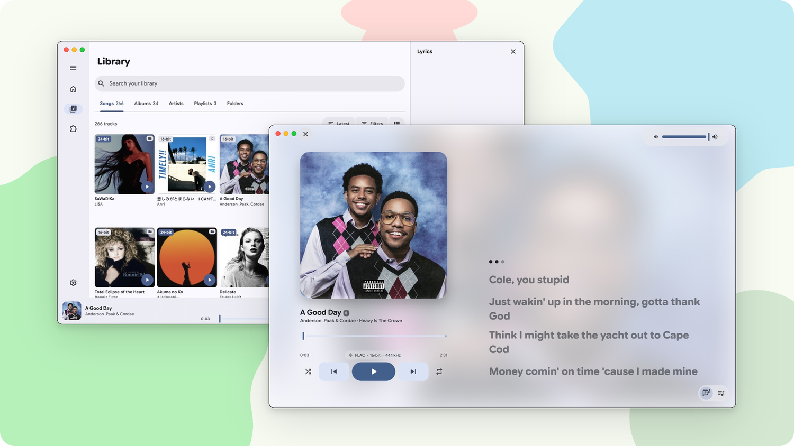

<div align="center">

<picture>
  <source media="(prefers-color-scheme: dark)" srcset="https://raw.githubusercontent.com/mornyeapp/Mornye/main/assets/brand/logo/svg/mornye-lockup-horizontal-dark.svg">
  <source media="(prefers-color-scheme: light)" srcset="https://raw.githubusercontent.com/mornyeapp/Mornye/main/assets/brand/logo/svg/mornye-lockup-horizontal-light.svg">
  
</picture>

<h3>Your music library, now on the big screen.</h3>

<p>
  
  
  
</p>

</div>

<p align="center">
  <a href="https://github.com/mornyeapp/Mornye-Desktop/releases/latest">
    <picture>
      <source media="(prefers-color-scheme: dark)" srcset="https://raw.githubusercontent.com/mornyeapp/Mornye/main/assets/readme/badges/badge-release-dark.svg">
      
    </picture>
  </a>
  <a href="https://crowdin.com/project/mornye">
    <picture>
      <source media="(prefers-color-scheme: dark)" srcset="https://raw.githubusercontent.com/mornyeapp/Mornye/main/assets/readme/badges/badge-crowdin-dark.svg">
      
    </picture>
  </a>
</p>

<p align="center">
  <a href="https://t.me/mornyeupdates">
    <picture>
      <source media="(prefers-color-scheme: dark)" srcset="https://raw.githubusercontent.com/mornyeapp/Mornye/main/assets/readme/badges/badge-telegram-channel-dark.svg">
      
    </picture>
  </a>
  <a href="https://t.me/mornyecommunity">
    <picture>
      <source media="(prefers-color-scheme: dark)" srcset="https://raw.githubusercontent.com/mornyeapp/Mornye/main/assets/readme/badges/badge-telegram-community-dark.svg">
      
    </picture>
  </a>
</p>

<p align="center">
  Source code available on <a href="https://github.com/mornyeapp/Mornye"><b>Mornye</b></a>
</p>

## <picture><source media="(prefers-color-scheme: dark)" srcset="https://raw.githubusercontent.com/mornyeapp/Mornye/main/assets/readme/sections/section-screenshots-dark.svg"></picture> Screenshots

<picture>
  <source media="(prefers-color-scheme: dark)" srcset="assets/screenshots/desktop-dark.png">
  
</picture>

---

## <picture><source media="(prefers-color-scheme: dark)" srcset="https://raw.githubusercontent.com/mornyeapp/Mornye/main/assets/readme/sections/section-features-dark.svg"></picture> Features

<table>
  <tr>
    <td width="50%" valign="top">
      <p>
        <picture>
          <source media="(prefers-color-scheme: dark)" srcset="https://raw.githubusercontent.com/mornyeapp/Mornye/main/assets/readme/features/feature-look-dark.svg">
          
        </picture>
        <br><b>Made for the desktop</b>
      </p>
      <p>
        A sidebar with your Library pages and playlists, a floating player,
        a native menu bar and window that blends into the title bar. Pick
        the Mornye theme, inspired by Apple's design, or Material 3
        Expressive.
      </p>
      <p></p>
    </td>
    <td width="50%" valign="top">
      <p>
        <picture>
          <source media="(prefers-color-scheme: dark)" srcset="https://raw.githubusercontent.com/mornyeapp/Mornye/main/assets/readme/features/feature-player-dark.svg">
          
        </picture>
        <br><b>A player that fills the room</b>
      </p>
      <p>
        Lyrics and Up Next open in a panel beside whatever you are browsing.
        Go full screen and the player takes over: the cover and controls on
        one side, large lyrics on the other, over a backdrop drawn from the
        artwork.
      </p>
      <p></p>
    </td>
  </tr>
  <tr>
    <td width="50%" valign="top">
      <p>
        <picture>
          <source media="(prefers-color-scheme: dark)" srcset="https://raw.githubusercontent.com/mornyeapp/Mornye/main/assets/readme/features/feature-library-dark.svg">
          
        </picture>
        <br><b>A library that keeps up</b>
      </p>
      <p>
        Add your music folders and Mornye watches them, picking up new
        albums as they land. Browse songs in a sortable table, select with
        Shift and Cmd / Ctrl clicks, review duplicates, edit metadata and
        export collections as M3U8.
      </p>
      <p></p>
    </td>
    <td width="50%" valign="top">
      <p>
        <picture>
          <source media="(prefers-color-scheme: dark)" srcset="https://raw.githubusercontent.com/mornyeapp/Mornye/main/assets/readme/features/feature-lyrics-dark.svg">
          
        </picture>
        <br><b>Lyrics</b>
      </p>
      <p>
        Synced lyrics with word-by-word timing, optional translation and
        romanization lines, and a reorderable chain of lyrics providers,
        including Zarz-LRC. Files without lyrics can search online from the
        player.
      </p>
      <p></p>
    </td>
  </tr>
  <tr>
    <td width="50%" valign="top">
      <p>
        <picture>
          <source media="(prefers-color-scheme: dark)" srcset="https://raw.githubusercontent.com/mornyeapp/Mornye/main/assets/readme/features/feature-hires-dark.svg">
          
        </picture>
        <br><b>Keyboard first</b>
      </p>
      <p>
        Space to play or pause, arrows with Cmd / Ctrl to skip and set the
        volume, Cmd / Ctrl + 1 to 5 to switch pages, Escape to step back.
        Every shortcut is listed in the menu bar and in button tooltips.
      </p>
      <p></p>
    </td>
    <td width="50%" valign="top">
      <p>
        <picture>
          <source media="(prefers-color-scheme: dark)" srcset="https://raw.githubusercontent.com/mornyeapp/Mornye/main/assets/readme/features/feature-network-dark.svg">
          
        </picture>
        <br><b>Network storage</b>
      </p>
      <p>
        Play music from SMB, WebDAV and HTTP / HTTPS servers. HTTPS
        connections can trust a single approved certificate fingerprint.
      </p>
      <p></p>
    </td>
  </tr>
  <tr>
    <td width="50%" valign="top">
      <p>
        <picture>
          <source media="(prefers-color-scheme: dark)" srcset="https://raw.githubusercontent.com/mornyeapp/Mornye/main/assets/readme/features/feature-extensions-dark.svg">
          
        </picture>
        <br><b>Extensions</b>
      </p>
      <p>
        Add metadata and lyrics sources from community extension
        repositories, then choose their priority. Building one? See the
        <a href="https://mornye.com/docs">extension documentation</a>.
      </p>
      <p></p>
    </td>
    <td width="50%" valign="top">
      <p>
        <picture>
          <source media="(prefers-color-scheme: dark)" srcset="https://raw.githubusercontent.com/mornyeapp/Mornye/main/assets/readme/features/feature-keep-dark.svg">
          
        </picture>
        <br><b>Yours to keep</b>
      </p>
      <p>
        Back up and restore settings, history and playlists, and carry them
        between your phone and your computer. Open source and available in
        20 languages.
      </p>
      <p></p>
    </td>
  </tr>
</table>

---

## <picture><source media="(prefers-color-scheme: dark)" srcset="https://raw.githubusercontent.com/mornyeapp/Mornye/main/assets/readme/sections/section-faq-dark.svg"></picture> FAQ

<details>
<summary><b>macOS says Mornye cannot be opened. What now?</b></summary>
<br>

If macOS stops the first launch, open **System Settings > Privacy & Security**,
scroll down and click **Open Anyway** next to the message about Mornye. You
only need to do this once.

</details>

<details>
<summary><b>Windows shows "Windows protected your PC".</b></summary>
<br>

SmartScreen warns about apps it has not seen often. Click **More info**, then
**Run anyway**. You can also use the portable zip if you prefer not to install
anything.

</details>

<details>
<summary><b>How do I run the AppImage?</b></summary>
<br>

Mark it as executable and start it:

```sh
chmod +x Mornye-*-linux-x86_64.AppImage
./Mornye-*-linux-x86_64.AppImage
```

The folder picker uses your desktop's portal, so install
`xdg-desktop-portal` (and the one for your desktop, such as
`xdg-desktop-portal-gtk` or `-kde`) if choosing a folder does nothing.

</details>

<details>
<summary><b>How do I add my music?</b></summary>
<br>

Open **Settings > Local Library** and add your music folders. Mornye scans
them, then keeps watching for new and changed files while it is open, so the
Library stays current without a manual rescan.

</details>

<details>
<summary><b>Where are the lyrics in full screen?</b></summary>
<br>

Press the lyrics button in the player (or Cmd / Ctrl + Shift + L) while the
window is in full screen and the player fills the screen with the cover on
one side and lyrics on the other. Press Escape or the close button to go back.

</details>

<details>
<summary><b>Can I move my library from the phone app?</b></summary>
<br>

Yes. Back up from the phone app, then restore the backup on the desktop.
Settings, history and playlists come along.

</details>

<details>
<summary><b>Is this app safe?</b></summary>
<br>

Mornye is open source. Its code and the build workflows that produce the
desktop releases can be inspected in
[Mornye](https://github.com/mornyeapp/Mornye).

</details>

> [!NOTE]
> If Mornye is useful to you, consider supporting development:
>
> [](https://ko-fi.com/zarzet)

---

## <picture><source media="(prefers-color-scheme: dark)" srcset="https://raw.githubusercontent.com/mornyeapp/Mornye/main/assets/readme/sections/section-development-dark.svg"></picture> Development

The desktop app is built from the same Flutter/Dart UI and Rust backend as
the phone app. Source code, issues and pull requests live in
[Mornye](https://github.com/mornyeapp/Mornye); see its
[Contributing Guide](https://github.com/mornyeapp/Mornye/blob/main/CONTRIBUTING.md)
to get started.

---

## <picture><source media="(prefers-color-scheme: dark)" srcset="https://raw.githubusercontent.com/mornyeapp/Mornye/main/assets/readme/sections/section-contributors-dark.svg"></picture> Contributors

Thanks to everyone who has contributed to Mornye!

<a href="https://github.com/mornyeapp/Mornye/graphs/contributors">
  
</a>

We also appreciate everyone who helped with [translations on Crowdin](https://crowdin.com/project/mornye), reported bugs, suggested features, and spread the word.

---

## <picture><source media="(prefers-color-scheme: dark)" srcset="https://raw.githubusercontent.com/mornyeapp/Mornye/main/assets/readme/sections/section-credits-dark.svg"></picture> API Credits

<p align="center">
  <a href="https://lyrics.paxsenix.org"><b>Paxsenix</b></a> &nbsp;·&nbsp;
  <a href="https://lrc.red"><b>lrc.red</b></a> &nbsp;·&nbsp;
  <a href="https://github.com/ibratabian17/LyricsPlus"><b>LyricsPlus</b></a> &nbsp;·&nbsp;
  <a href="https://lrclib.net"><b>LRCLib</b></a> &nbsp;·&nbsp;
  <a href="https://betterlyrics.org"><b>BetterLyrics</b></a> &nbsp;·&nbsp;
  <a href="https://developers.deezer.com"><b>Deezer</b></a> &nbsp;·&nbsp;
  <a href="https://musicbrainz.org"><b>MusicBrainz</b></a> &nbsp;·&nbsp;
  <a href="https://song.link"><b>Song.link</b></a> &nbsp;·&nbsp;
  <a href="https://github.com/FlazeIGuess/unitune-api"><b>UniTune</b></a> &nbsp;·&nbsp;
  <a href="https://squigly.link"><b>Squigly</b></a>
</p>

---

## <picture><source media="(prefers-color-scheme: dark)" srcset="https://raw.githubusercontent.com/mornyeapp/Mornye/main/assets/readme/sections/section-disclaimer-dark.svg"></picture> Disclaimer

This repository and its contents are provided strictly for educational and research purposes. The software is provided "as-is" without warranty of any kind, express or implied, as stated in the [MIT License](https://github.com/mornyeapp/Mornye/blob/main/LICENSE).

- No copyrighted content is hosted, stored, mirrored, or distributed by this repository.
- Users must ensure that their use of this software is properly authorized and complies with all applicable laws, regulations, and third-party terms of service.
- This software is provided free of charge by the maintainer. If you paid a third party for access to this software in its original form from this repository, you may have been misled or scammed. Any redistribution or commercial use by third parties must comply with the terms of the repository license. No affiliation, endorsement, or support by the maintainer is implied unless explicitly stated in writing.
- Mornye is an independent project. It is not affiliated with, endorsed by, or connected to any other project or version on other platforms that may share a similar name. The maintainer of this repository has no control over or responsibility for third-party projects.
- The author(s) disclaim all liability for any direct, indirect, incidental, or consequential damages arising from the use or misuse of this software. Users assume all risk associated with its use.
- If you are a copyright holder or authorized representative and believe this repository infringes upon your rights, please contact the maintainer with sufficient detail (including relevant URLs and proof of ownership). The matter will be promptly investigated and appropriate action will be taken, which may include removal of the referenced material.

> [!TIP]
> **Star the repo** to get notified about all new desktop releases directly from GitHub.
